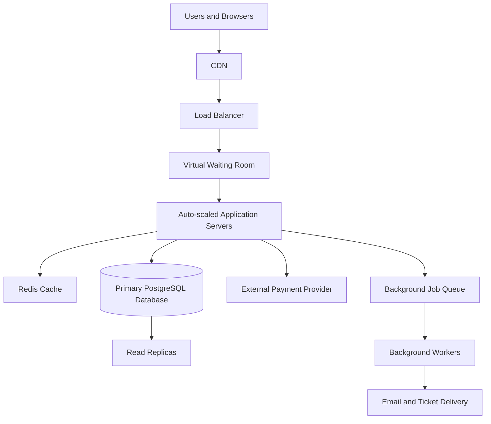

# TicketHub - Design Document

## 1. Requirements

TicketHub is a ticket-selling website that allows users to browse events, select seats, make payments, and access purchased tickets. It must support 2 million registered users and handle sudden increases in traffic during popular concert sales.

### 1.1 Functional Requirements

- Users can register, log in, and manage their accounts.
- Users can browse and search events by name, city, venue, and date.
- Users can view event details, ticket prices, and seat availability.
- Users can hold available seats for 10 minutes while completing payment.
- Users can pay for tickets and receive confirmation after successful payment.
- Users can view their purchased tickets and order history.
- The system can release expired seat holds so other customers can purchase those seats.

### 1.2 Non-Functional Requirements

**Speed:** Event pages should load in under 1 second under normal conditions. During a major sale, the system should remain responsive and provide clear waiting-room information.

**Scalability:** The system should handle approximately 3,300 requests per second during a popular sale by distributing traffic across multiple application servers and using caching and a virtual waiting room.

**Correctness:** A seat must never be sold to two customers. Seat holds, orders, and payment confirmations must be processed consistently.

**Fairness:** Users should enter the purchasing process according to a transparent queue policy. Rate limiting should reduce excessive refreshes and automated buying. Strict arrival-order fairness requires reliable queue timestamps and queue tokens.

**Availability:** Application server failures should not bring down the entire website. The system should use health checks and redundant components where practical.

**Security:** User accounts and transactions must be protected using HTTPS, authentication, authorization, and secure payment-provider integration. Raw payment-card details should not be stored by TicketHub.

**Reliability:** Repeated payment requests must not create duplicate charges or tickets. Failed and delayed payments must be handled safely.

## 2. Traffic Estimates

For these estimates, one day is approximately 100,000 seconds. The normal-day request estimate is based on page views, while the big-sale estimate assumes that each potential buyer makes approximately 10 requests.

### 2.1 Normal Traffic

- Daily visitors: 50,000
- Pages viewed per visitor: 10
- Total daily page views: 50,000 × 10 = 500,000
- Average requests per second: 500,000 ÷ 100,000 = approximately 5 requests per second

This is a relatively small average workload. Actual traffic may be higher during busy periods.

### 2.2 Big-Sale Traffic

- Potential buyers: 200,000
- Requests per buyer: approximately 10
- Total requests: 200,000 × 10 = 2,000,000
- Sale duration: 10 minutes = 600 seconds
- Average requests per second: 2,000,000 ÷ 600 = approximately 3,333 requests per second

The estimated big-sale traffic is approximately 667 times the normal average traffic:

3,333 ÷ 5 ≈ 667.

There are only 20,000 seats available. Therefore, at most 20,000 buyers can obtain a seat, leaving 180,000 potential buyers without tickets if all seats are sold.

This creates two main challenges: handling the sudden traffic spike and preventing multiple buyers from purchasing the same seat.

The estimate assumes 10 requests per buyer. It is a planning estimate, not a guaranteed peak rate. The system should be load-tested above this average to account for traffic bursts, retries, and background operations.

## 3. API Design

TicketHub will use a REST API. Clients communicate with the application server through HTTP requests, and responses are normally returned in JSON format.

| Method and endpoint | Purpose | Expected response |
|---|---|---|
| GET /events?search=&city= | Browse and search events | 200 OK |
| GET /events/{id} | View event details | 200 OK |
| GET /events/{id}/seats | View seat availability | 200 OK |
| POST /holds | Hold one or more available seats | 201 Created or 409 Conflict |
| POST /orders | Create a pending order and initiate payment | 201 Created or an appropriate error |
| GET /me/tickets | View the authenticated user's tickets | 200 OK |

### Example: Holding Seats

Request:

```http
POST /holds
Content-Type: application/json
```

```json
{
  "eventId": 7,
  "seatIds": [101, 102]
}
```

A successful response contains a hold ID and expiry time. If any requested seat cannot be held, the system returns `409 Conflict` and does not create a partial hold.

### Example: Creating an Order

The client submits the hold ID and a payment-provider token. The server validates the hold and initiates payment. The order remains pending until successful payment is verified.

The server issues tickets only after confirming successful payment. An idempotency key prevents retries from creating duplicate orders or charges.

A `409 Conflict` response means the requested operation conflicts with the current state, such as when a seat has already been held or sold.

## 4. Data Model

TicketHub will use a relational database such as PostgreSQL because it supports transactions, foreign keys, row-level locking, and unique constraints.

### 4.1 Users Table

| Column | Description |
|---|---|
| id (PK) | Unique user identifier |
| name | User's full name |
| email (UNIQUE) | User's email address |
| password_hash | Secure password hash |
| created_at | Account creation time |

### 4.2 Events Table

| Column | Description |
|---|---|
| id (PK) | Unique event identifier |
| name | Event name |
| venue | Event location |
| starts_at | Event date and time |
| status | Scheduled, on sale, or cancelled |

### 4.3 Seats Table

| Column | Description |
|---|---|
| id (PK) | Unique seat identifier |
| event_id (FK) | References events.id |
| section | Seating section |
| row | Row identifier |
| number | Seat number |
| status | Available, held, or sold |
| hold_id | Identifier for the active hold |
| hold_expires_at | Expiry time for the hold |

A unique constraint on `(event_id, section, row, number)` prevents duplicate seat records for the same event.

### 4.4 Orders Table

| Column | Description |
|---|---|
| id (PK) | Unique order identifier |
| user_id (FK) | References users.id |
| total | Total order amount |
| status | Pending, paid, cancelled, or failed |
| payment_reference (UNIQUE where present) | Payment-provider reference |
| created_at | Order creation time |

### 4.5 Order_Seats Table

| Column | Description |
|---|---|
| order_id (FK) | References orders.id |
| seat_id (FK, UNIQUE) | References seats.id |

The unique constraint on `order_seats.seat_id` ensures that a seat cannot belong to more than one order.

### 4.6 Relationships

- One user can have many orders.
- One event can have many seats.
- Each seat belongs to one event.
- One order can contain multiple seats.
- Each seat can belong to at most one order.

Primary keys uniquely identify records, foreign keys enforce relationships, and unique constraints prevent duplicate records or conflicting ownership.

## 5. Preventing Double-Booking

The database, rather than the application servers or cache, is responsible for guaranteeing that a seat cannot be held or sold by two customers simultaneously.

Checking whether a seat is available in the application and then updating it in a separate operation is unsafe. Two requests could both see the seat as available before either update occurs.

TicketHub instead uses a conditional update inside a database transaction.

### 5.1 Seat-Holding Process

1. The user selects the required seats.
2. The application starts a database transaction.
3. The database attempts to change each seat from available to held, or reclaim it if its previous hold has expired.
4. The application checks whether every requested seat was successfully updated.
5. If fewer seats were updated than requested, the transaction rolls back and returns `409 Conflict`.
6. If every seat was updated, the transaction commits and returns the hold ID and expiry time.

Example for holding two seats:

```sql
BEGIN;

UPDATE seats
SET status = 'held',
    hold_id = 55,
    hold_expires_at = CURRENT_TIMESTAMP
        + INTERVAL '10 minutes'
WHERE id IN (101, 102)
  AND event_id = 7
  AND (
      status = 'available'
      OR (
          status = 'held'
          AND hold_expires_at < CURRENT_TIMESTAMP
      )
  )
RETURNING id;

-- Application checks the returned row count.
-- If it is not exactly 2, execute ROLLBACK.
-- Otherwise, execute COMMIT.

COMMIT;
```

The application must perform the row-count check before committing. If fewer than two seats were returned, it must roll back the transaction instead of accepting a partial hold.

The database coordinates concurrent updates to the same rows. Once one transaction successfully holds a seat, a competing transaction cannot also change that seat from available to held. Its conditional update will not succeed for that seat.

### 5.2 Payment and Order Confirmation

After a hold is created, the customer completes payment within the 10-minute hold period.

The application verifies the payment confirmation from the payment provider. It then uses a database transaction to create or finalize the order, associate the seats with the order, and mark the seats as sold.

The unique constraint on `order_seats.seat_id` provides an additional safeguard against assigning a seat to multiple orders.

Payment-provider communication should not take place while database row locks are held open. The application should use idempotency keys, verified payment notifications, and a reconciliation process to handle delayed or repeated payment confirmations.

If a payment fails or a hold expires before payment is confirmed, the application must follow a defined recovery process. It must not issue a ticket without verified payment or allow an expired hold to override a valid purchase.

### 5.3 Releasing Expired Holds

Expired holds are not released automatically merely because their expiry timestamp has passed. The system needs a process to release them, such as a scheduled worker or a safe conditional update when another buyer requests the seat.

This allows abandoned seats to become available again while protecting seats that are still held or already sold.

## 6. System Architecture

### 6.1 Architecture Diagram



### 6.2 Component Explanations

**CDN:** Delivers static assets such as images, stylesheets, JavaScript, and cacheable event pages from geographically distributed servers. This reduces the traffic reaching the application.

**Load balancer:** Distributes incoming requests among healthy application servers and avoids sending new requests to unhealthy instances.

**Virtual waiting room:** Places visitors in a controlled queue during major sales. It admits buyers at a rate the purchasing system can handle and uses queue tokens and rate limits to reduce excessive refreshes and automated buying. A target admission rate, such as approximately 2,000 buyers at a time, must be validated through load testing rather than assumed to be safe.

**Application servers:** Handle event browsing, authentication, seat holds, orders, and ticket retrieval. Multiple stateless application instances can be added before a scheduled sale to handle increased demand.

**Redis cache:** Stores frequently accessed event information and short-lived seat-map snapshots. Cached seat information may become outdated, so the database must always perform the final availability check before a hold or purchase succeeds.

**Primary PostgreSQL database:** Stores authoritative seat statuses, holds, and orders. Transactions, conditional updates, and unique constraints protect correctness. All seat-hold and purchase decisions must be validated against this authoritative database.

**Read replicas:** Handle suitable read-only requests, such as event browsing and search, to reduce the workload on the primary database. Replicas may lag behind the primary, so they must not be used to make final seat-purchase decisions.

**External payment provider:** Processes payments securely and provides verified payment confirmations. Idempotency and reconciliation help prevent duplicate charges and resolve uncertain outcomes.

**Background job queue and workers:** Generate ticket PDFs, send email confirmations, and process other non-critical tasks after successful payment. These operations run outside the immediate checkout request so that ticket purchases are not delayed by email delivery.

### 6.3 Surviving the Big Sale

The CDN serves static content without sending every request to the application servers. The virtual waiting room controls how many visitors enter the purchasing process, while the load balancer distributes admitted traffic among multiple application instances.

Redis reduces repeated reads for event information. Read replicas serve suitable browsing queries, leaving the primary database to handle seat holds and orders. The primary database remains the final authority for seat availability, regardless of what the cache displays.

Background workers handle ticket delivery after payment, reducing checkout workload. Monitoring, health checks, load testing, and automatic scaling help identify bottlenecks and respond to failures.

The architecture must be tested under realistic concurrent purchasing conditions. Scaling the application servers alone is not sufficient if the primary database or payment provider becomes the bottleneck.

## 7. Trade-Offs

### 7.1 Correctness vs. Availability

Seat holds and orders must use the primary database, even if database contention increases waiting time. This may temporarily reduce checkout availability during heavy demand.

**Decision:** Prioritize correct seat ownership over accepting a potentially conflicting purchase. Returning a retry or conflict response is better than selling the same seat twice.

### 7.2 Freshness vs. Speed

Caching seat maps makes browsing faster and reduces database load, but the displayed availability may be several seconds out of date.

**Decision:** Allow short-lived caching for display purposes while checking every hold against the primary database. If a seat is no longer available, return `409 Conflict` and ask the buyer to select another seat.

### 7.3 Fairness vs. Simplicity

A virtual waiting room adds infrastructure and operational complexity, but it reduces overload and helps prevent users with automated scripts or excessive refreshes from dominating the sale.

**Decision:** Use a transparent queue policy, rate limiting, and queue tokens. Clearly communicate the admission policy and avoid claiming strict first-arrival fairness unless arrival order can be reliably established and enforced.

### 7.4 Temporary Holds vs. Seat Utilization

Ten-minute holds give customers time to pay but can temporarily prevent other customers from purchasing seats when someone abandons checkout.

**Decision:** Use a clearly communicated 10-minute expiry, safely release expired holds, and reconcile delayed payment confirmations before making conflicting seat assignments.

## Conclusion

TicketHub must handle both ordinary browsing and sudden high-demand sales while guaranteeing that each seat can be sold only once. The estimated big-sale traffic is approximately 3,333 requests per second, far above the normal average of five requests per second.

A CDN, waiting room, load balancer, scalable application servers, cache, read replicas, and background workers help control the traffic. However, the essential correctness guarantee comes from the primary database, using atomic conditional updates, transactions, and unique constraints to prevent double-booking.