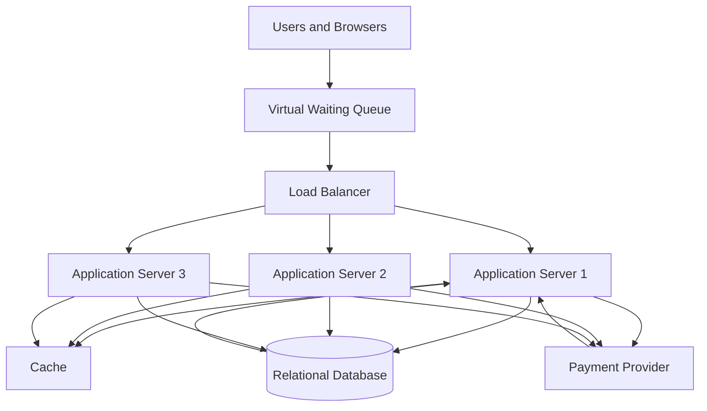

 # TicketHub: System Design

## 1. Requirements

TicketHub is a website where users browse concerts and events, view available seats, purchase tickets, and access their purchased tickets. The system must support 2 million registered users and remain reliable when a popular concert goes on sale.

### 1.1 Functional Requirements

The system must allow users to:

1. Register, log in, and manage their accounts.
2. Browse upcoming events and search for concerts by name, date, venue, or category.
3. View event details, prices, and available seats.
4. Temporarily hold an available seat while completing checkout.
5. Pay for tickets and receive purchase confirmation.
6. View their purchased tickets and order history.
7. Release expired seat holds so that other users can purchase those seats.

### 1.2 Non-Functional Requirements

**Speed:** Event listings and seat availability should load within approximately 2 seconds under normal conditions. During a major sale, the system should remain responsive and provide clear queue or waiting messages rather than becoming unavailable.

**Correctness:** A seat must never be sold to two different customers. Payments must be recorded accurately, and users should receive tickets only after successful payment confirmation.

**Fairness:** During a popular sale, users should be admitted through a controlled waiting queue. Requests should be processed according to the queue policy, with rate limiting to reduce automated buying and abuse. The system should not promise a seat until it has been successfully held.

**Availability:** The website should continue operating if an application server fails. Failed payment attempts must not cause a seat to be incorrectly marked as sold.

**Scalability:** The system must support increasing traffic by adding application servers and distributing requests across them.

**Security:** User accounts and payment operations must be protected. The system should use HTTPS, authentication, authorization, and a trusted payment provider. Sensitive card details should not be stored directly by TicketHub.

**Consistency:** Seat availability and order status must be updated reliably, even when multiple users attempt to purchase the same seat at nearly the same time.

## 2. Traffic Estimates

The estimates use the assumption that one day is approximately 100,000 seconds. Average traffic is useful for planning, but real traffic can be higher during busy periods.

### 2.1 Normal Daily Traffic

Registered users: 2,000,000

Daily visitors: 50,000

Pages viewed per visitor: 10

Total page views per day:

50,000 × 10 = 500,000 page views per day.

Average page views per second:

500,000 ÷ 100,000 = approximately 5 page views per second.

Tickets sold per day: 5,000

Average ticket sales per second:

5,000 ÷ 100,000 = 0.05 tickets per second.

This is approximately one ticket sold every 20 seconds on average.

### 2.2 Popular Concert Sale

During a major sale, 200,000 people try to purchase tickets for 20,000 available seats within the first 10 minutes.

Ten minutes = 600 seconds.

Average purchase attempts per second:

200,000 ÷ 600 = approximately 333 attempts per second.

Maximum ticket sales per second if all 20,000 seats sell within 10 minutes:

20,000 ÷ 600 = approximately 33 tickets per second.

There are ten potential buyers for every available seat:

200,000 ÷ 20,000 = 10.

Therefore, not every visitor can receive a ticket. The system must manage demand fairly and accurately.

### 2.3 Comparison

| Metric | Normal day | Popular sale |
|---|---:|---:|
| Visitors or buyers | 50,000 per day | 200,000 in 10 minutes |
| Page views | 500,000 per day | Not specified |
| Average page views per second | 5 | Not directly calculable |
| Ticket sales | 5,000 per day | Up to 20,000 in 10 minutes |
| Buyer attempts per second | Not specified | About 333 |
| Available seats | Depends on events | 20,000 |

The popular sale creates a much more concentrated workload. Its 333 buyer attempts per second cannot be compared directly with the normal five page views per second because they represent different types of requests. The system must also handle bursts, retries, seat checks, and payment operations. A waiting queue, caching, rate limiting, and safe database transactions will help manage the extra load.

These figures are average estimates rather than guaranteed peak rates. The system should be load-tested above the expected average.

## 3. API Design

TicketHub will provide a REST API. Clients send HTTP requests to the API, and the server returns responses, normally in JSON format.

| Method and endpoint | Purpose |
|---|---|
| GET /api/events | Browse upcoming events |
| GET /api/events/{eventId} | View event details |
| GET /api/events/{eventId}/seats | View seats and their availability |
| POST /api/events/{eventId}/holds | Temporarily hold a selected seat |
| POST /api/orders/{orderId}/payment | Initiate or confirm payment through a trusted payment provider |
| GET /api/users/me/tickets | View tickets belonging to the authenticated user |

The seat-hold request should contain the selected seat ID. The server checks availability and returns a hold ID and expiry time if the hold succeeds. If the seat is unavailable, it returns a conflict response, such as HTTP 409.

A payment request should use an idempotency key so that retries do not create duplicate charges or orders. The payment provider's verified confirmation should determine whether an order is paid.

For example, the API could return HTTP 201 when a hold is created successfully, HTTP 409 when a seat is no longer available, and HTTP 401 when authentication is required but missing.

## 4. Database Design

TicketHub will use a relational database such as PostgreSQL. Relational databases support transactions, foreign keys, and unique constraints, which are important for ticket sales.

### 4.1 Users Table

| Column | Description |
|---|---|
| user_id (PK) | Unique user identifier |
| full_name | User's name |
| email | Email address; must be unique |
| password_hash | Securely stored password hash |
| created_at | Account creation time |

### 4.2 Events Table

| Column | Description |
|---|---|
| event_id (PK) | Unique event identifier |
| event_name | Name of the concert or event |
| venue | Event location |
| event_date | Date and time of the event |
| status | Scheduled, on sale, or cancelled |

### 4.3 Seats Table

| Column | Description |
|---|---|
| seat_id (PK) | Unique seat identifier |
| event_id (FK) | References Events |
| seat_number | Seat label within the event |
| price | Ticket price |
| status | Available, held, or sold |
| held_by_user_id (FK, nullable) | User currently holding the seat |
| hold_expires_at (nullable) | Time when the temporary hold expires |

A unique constraint on (event_id, seat_number) prevents duplicate seat records for the same event.

### 4.4 Orders Table

| Column | Description |
|---|---|
| order_id (PK) | Unique order identifier |
| user_id (FK) | References Users |
| seat_id (FK) | References Seats |
| status | Pending, paid, cancelled, or failed |
| amount | Amount to be paid |
| payment_reference | Unique payment provider reference, when available |
| created_at | Order creation time |

The seat_id in Orders must also have a unique constraint if each seat can be sold only once. This provides an additional database-level safeguard against duplicate completed orders.

### 4.5 Relationships

- One user can place many orders.
- One event can have many seats.
- Each seat belongs to one event.
- Each order belongs to one user and references one seat.
- Each seat can have at most one order under the unique seat_id constraint.

Primary keys identify records. Foreign keys maintain valid relationships between tables. Unique constraints prevent duplicate records where uniqueness is required.

## 5. Preventing Double-Booking

Double-booking happens when two users try to purchase the same seat at nearly the same time. Checking availability only in the application is not sufficient because both requests might see the seat as available before either request updates it.

TicketHub will use database transactions, row locking or conditional updates, and unique constraints.

### Seat-holding process

1. The user selects a seat.
2. The server begins a database transaction.
3. The server attempts to change the seat from available to held only if it is still available, or its previous hold has expired.
4. The update records the holding user's ID and a short expiry time.
5. If exactly one row is updated, the hold succeeds. If no row is updated, another user has already held or purchased the seat.
6. The transaction commits, and the user receives the hold confirmation.

A conditional update can follow this pattern:

```sql
UPDATE seats
SET status = 'held',
    held_by_user_id = :user_id,
    hold_expires_at = :expiry_time
WHERE seat_id = :seat_id
  AND (
    status = 'available'
    OR (
      status = 'held'
      AND hold_expires_at < CURRENT_TIMESTAMP
    )
  );
```

The application must check the number of rows updated. Only one competing request can successfully change the same available seat to held. The database's row-level locking and transaction handling coordinate concurrent updates.

### Payment and confirmation

The user pays before the hold expires. After verified payment confirmation, the server starts a transaction, checks that the hold still belongs to the user and is valid, creates or finalizes the order, marks the seat as sold, and commits the changes together.

The unique constraints on seat_id and event/seat number provide additional protection. If the transaction fails, it is rolled back rather than leaving a partially completed sale.

Payment processing may happen outside the database transaction because external payment services can take time to respond. TicketHub should use verified payment webhooks, idempotency keys, and a defined recovery process for delayed or failed payments. It must not hold database locks open while waiting for a payment provider.

Expired holds are released so that other users can try to buy the seat. The system must also handle late payment confirmations carefully, refunding or reconciling payments where necessary rather than selling the same seat twice.

## 6. System Architecture

### 6.1 Architecture Diagram



### 6.2 Components

**Users and browsers:** Users browse events, select seats, pay for tickets, and access their purchases.

**Virtual waiting queue:** During a major sale, the queue controls how many users enter the purchasing process at once. It should use a clear admission policy, queue tokens, and rate limits to reduce overload and abusive requests.

**Load balancer:** Distributes requests among available application servers and stops directing new traffic to unhealthy servers.

**Application servers:** Handle authentication, event browsing, seat holds, order creation, and ticket retrieval. Multiple instances can be added as demand grows.

**Cache:** Stores frequently requested event details and other data that can safely be cached. This reduces repeated database queries. Live seat availability and purchase decisions must still be validated against the database.

**Relational database:** Stores users, events, seats, and orders. Transactions, row locking or conditional updates, and unique constraints protect seat ownership and order correctness.

**Payment provider:** Processes payments securely and sends verified payment confirmations. TicketHub uses idempotency and reconciliation to handle retries and uncertain payment outcomes.

### 6.3 Surviving the Big Sale

The waiting queue limits the rate at which users reach the purchase system. The load balancer distributes admitted requests among multiple application servers, and more servers can be added when needed.

Caching reduces load from event pages, while the relational database remains the authoritative source for seat availability. Database transactions and constraints prevent conflicting purchases even when requests reach different servers at the same time.

Health checks, monitoring, rate limits, and load testing help detect failures and prepare for traffic above the expected average. The queue improves traffic control, but it does not create additional seats or guarantee that everyone will get a ticket.

## 7. Design Trade-Offs

### 7.1 Strong Consistency vs. High Performance

Using database transactions and constraints makes seat purchases accurate, but concurrent updates can create lock contention and slow down checkout during a big sale.

**Decision:** Prioritize correctness for seat holds and purchases. Use caching for event browsing and optimize database queries without bypassing the authoritative seat checks.

### 7.2 Fair Access vs. Immediate Access

A virtual waiting queue helps prevent overload and gives users a structured way to enter the sale. However, users may have to wait, and queue management adds complexity.

**Decision:** Use a transparent queue with rate limiting and clear waiting information. Define and communicate the admission policy so users understand how access is managed.

### 7.3 Temporary Holds vs. Faster Checkout

Holding seats prevents users from losing their selected seats while paying, but abandoned checkouts temporarily reduce the number of seats available to other buyers.

**Decision:** Use short, clearly communicated hold periods and automatically release expired holds. Handle delayed payment confirmations carefully to avoid duplicate sales.

### 7.4 Caching vs. Fresh Information

Caching makes event pages faster and reduces database load, but cached seat availability can become outdated.

**Decision:** Cache event descriptions and other relatively stable information. Confirm seat availability using the database whenever a user attempts to hold or purchase a seat.

## Conclusion

TicketHub can support normal traffic and major concert sales by combining scalable application servers, a controlled waiting queue, caching, and a relational database. The most important design decision is that seat ownership must be enforced by the database, not merely by application logic. Transactions, conditional updates, and unique constraints prevent double-booking while the queue and scalable architecture help the system handle heavy demand.